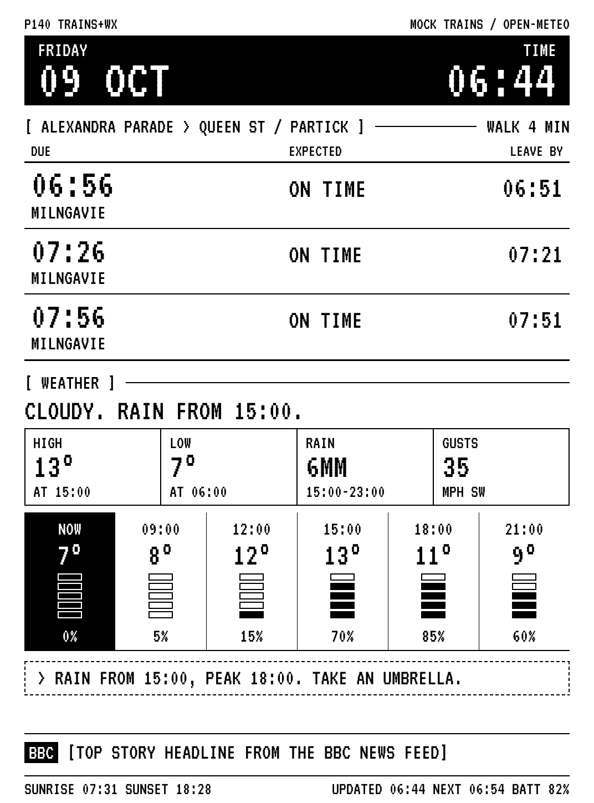
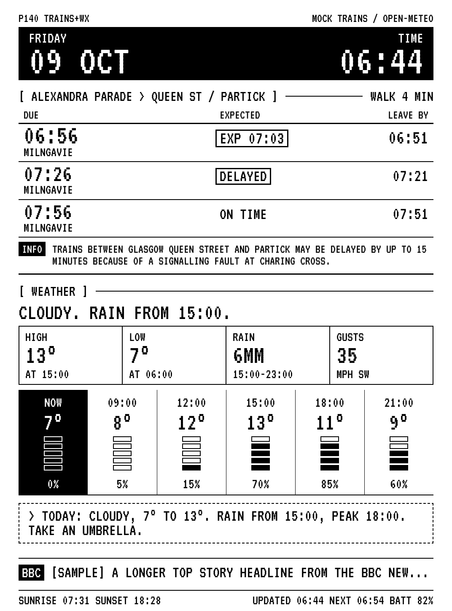
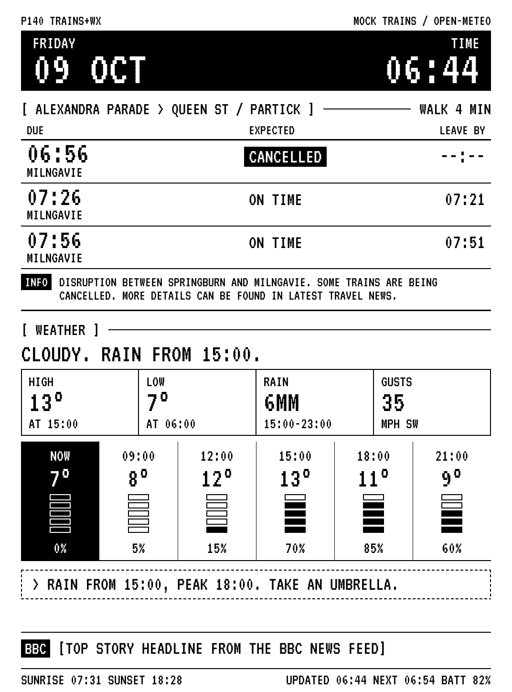
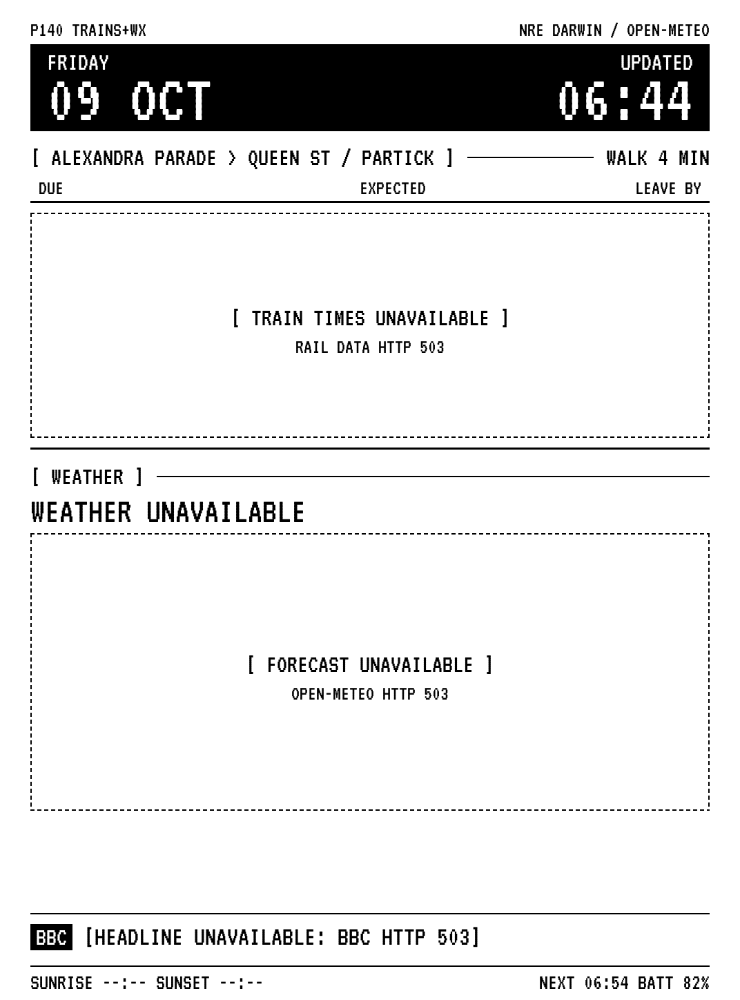

# Kindle dashboard: Cloudflare Worker

Returns a freshly drawn 1072×1448, 8-bit greyscale PNG on every request: the
next three trains from Alexandra Parade towards Queen St / Partick, today's
weather, the BBC top story, and a footer showing when it was drawn, the
Kindle's next refresh time and its battery level. The time in the top right is
kept current by the Kindle between fetches (see [The clock](#the-clock)). The layout follows [`docs/mockup.png`](../docs/mockup.png).

| Normal | Delayed | Cancelled | Upstreams down |
| --- | --- | --- | --- |
|  |  |  |  |

## How the image is drawn

Workers have no canvas, no native graphics libraries and, on the free plan,
only **10 ms of CPU per request**. The usual options don't fit:

- **Satori + resvg-wasm** (what `@vercel/og` uses) ships about 2 MB of
  WebAssembly. It also renders through SVG to an RGBA PNG, which would need
  converting to greyscale afterwards. Typical renders take tens to hundreds
  of ms of CPU.
- **Browser Rendering** (headless Chrome) is slow and costs extra.
- **Pre-rendered bitmap fonts** would work, but would not use the font file itself.

So the Worker draws the image itself in plain TypeScript, with no
dependencies (bundle: 61 KB gzipped):

1. **Font:** `fonts/VT323-Regular.ttf` (SIL OFL 1.1, licence in
   `fonts/OFL.txt`) is bundled as a binary module. A small TrueType reader
   (`src/render/ttf.ts`) reads the glyph outlines.
2. **Glyphs:** an anti-aliased scanline rasteriser (`src/render/raster.ts`)
   turns each outline into a coverage mask, cached per size.
3. **Layout:** text, rules, boxes and reversed-out panels are drawn into a
   one-byte-per-pixel buffer (`src/layout.ts`, `src/render/canvas.ts`).
4. **PNG:** `src/render/png.ts` writes an 8-bit greyscale PNG (colour type 0,
   which `eips -g` displays directly). Instead of zlib, it uses a small deflate
   encoder made for this kind of image. Blank rows, solid rows and rows
   identical to the row above are written in one step, and only the rest are
   scanned. zlib took 20–40 ms per frame; this takes about 5 ms and gives a
   100–130 KB file.

At startup the Worker parses the font, rasterises every glyph it can need and
renders one sample frame. Startup has its own time limit, separate from the
per-request CPU limit.

**CPU figures** (measured locally on Node/V8; Cloudflare's machines will
differ): about 7–8 ms per request once the isolate is warm, and about 20 ms
for the first request after a fresh start. The free plan allows an
occasional overrun of the 10 ms limit, but not consistent ones. After deploying, check CPU time under
**Workers & Pages → kindle-dashboard → Logs** (observability is switched
on in `wrangler.toml`). If you see `Error 1102 Worker exceeded resource limits`,
either move to Workers Paid ($5/month, 30 s CPU limit) or live with it: the
Kindle keeps its last image when a fetch fails.

## Image URL

```
https://kindle-dashboard.<your-subdomain>.workers.dev/?k=<ACCESS_TOKEN>&batt=<0-100>&next=<HH:MM>
```

| Parameter | Meaning |
| --- | --- |
| `k` | Required. Must match the `ACCESS_TOKEN` secret, otherwise the response is `403`. |
| `batt` | Battery %, shown in the footer (`BATT 82%`). Optional. |
| `next` | Next refresh time, shown in the footer (`NEXT 06:54`). Optional. |

The footer also shows when the image was drawn (`UPDATED 06:44`).
| `mock` | `normal`, `delayed` or `cancelled`. Overrides `MOCK_SCENARIO` while trains are in mock mode. |
| `format=json` | Returns the data behind the image instead of the PNG, for debugging. |

Responses are `image/png` with `cache-control: no-store`. If an upstream API
fails, its section is marked as unavailable and the rest is drawn as normal
(the status is still `200`). Only a failure to draw the image at all returns
`500`, so the Kindle can keep its previous image.

## The clock

The top right shows the current time. The Worker draws it as at the moment of
the request. Between fetches the Kindle keeps it current without Wi-Fi: each
minute it pastes in the digits that changed, from ten small images in
[`kindle/dashboard/clock/`](../kindle/dashboard/clock). Each image is cut from
the dashboard exactly as the Worker draws that digit, and `clock.sh` there
records where the digits go.

If you change the clock's font, size or position in `src/layout.ts`, run
`npm run clock` to remake those files, then reinstall them on the Kindle.
`test/clock.test.ts` checks two things: pasting the images gives exactly the
image the Worker would draw at that time, and the files in the repository are
up to date.

## Preview locally

Needs Node.js 22 or later (Wrangler requires it).

```sh
cd worker
npm install
npm run preview        # writes preview/normal.png, delayed.png, cancelled.png, unavailable.png
```

The preview uses offline sample data (Fri 09 Oct, 06:44, the same numbers as
the mockup). `npm run preview:live` instead fetches real Open-Meteo and BBC
data for the current time and writes `preview/live.png`. Trains stay mock
unless `RDM_KEY` is set in your shell.

To run the actual Worker locally: copy `.dev.vars.example` to `.dev.vars`,
choose any local test token, run `npm run dev`, then open
`http://localhost:8787/?k=<that token>&batt=82&next=06:54`.

Tests and type checks: `npm test` and `npm run typecheck`.

## Deploy

Things to do by hand (on your own computer, with Node.js 22 or later installed):

1. Get the code and install dependencies:
   ```sh
   git clone https://github.com/samlesley/kindle_dashboard.git
   cd kindle_dashboard
   git checkout claude/gallant-turing-2e4kkf   # skip once this is merged into main
   cd worker
   npm install
   ```
2. Log in to Cloudflare: `npx wrangler login` (opens a browser).
3. Deploy: `npx wrangler deploy`. On the first deploy, Wrangler creates the
   `CACHE` KV namespace and writes its id back into `wrangler.toml`. If it asks,
   choose to create a new namespace. Commit the updated `wrangler.toml` if you like;
   the namespace stays linked either way. The output ends with your URL,
   `https://kindle-dashboard.<your-subdomain>.workers.dev`.
4. Make an access token on your own machine and keep it somewhere safe, for example with
   `node -e "console.log(require('crypto').randomBytes(24).toString('hex'))"`.
5. Store it as a secret: `npx wrangler secret put ACCESS_TOKEN`, then paste
   the token when Wrangler prompts for it. Until this is set, every request gets `403`.
6. Check it in a browser: open
   `https://kindle-dashboard.<your-subdomain>.workers.dev/?k=<token>&batt=82&next=06:54`.
   You should see the dashboard with mock trains (top right says `MOCK TRAINS`).

When Rail Data Marketplace approves your account:

7. On raildata.org.uk, subscribe to the **Live Departure Board** product.
   On its **Specification** tab, copy the consumer key, and check that the
   endpoint URL matches `LDB_URL` in `wrangler.toml` (everything before
   `/{crs}`). If the URL differs, update `LDB_URL`.
8. Store the key: `npx wrangler secret put RDM_KEY`, then paste the key when prompted.
9. Run `npx wrangler deploy`. (`LIVE_TRAINS` is already `"true"` in `wrangler.toml`;
   until `RDM_KEY` is set, the Worker uses mock trains.)
10. Check `…/?k=<token>&format=json`: `trainSource` should be `"live"` and
    `trains.ok` should be `true`. Top right of the image now says `NRE DARWIN`.

Secrets live only in Cloudflare (and in your local `.dev.vars`, which git
ignores). Neither is ever written to `wrangler.toml`.

## Configuration (`wrangler.toml` `[vars]`)

| Variable | Default | |
| --- | --- | --- |
| `LAT`, `LON` | `55.8637`, `-4.2107` | Forecast location (Alexandra Parade station). |
| `STATION_CRS` | `AXP` | Alexandra Parade. |
| `STATION_NAME` | `ALEXANDRA PARADE` | Shown in the departures heading. |
| `FILTER_CRS` | `PTK` | Only services calling at Partick. |
| `HEADING_TO` | `QUEEN ST / PARTICK` | Shown after the station name. |
| `WALK_MINUTES` | `4` | Hides trains expected sooner than this; leave-by = expected − this. |
| `LIVE_TRAINS` | `true` | `true` uses live data, but only when `RDM_KEY` is set. Otherwise, or when `false`, mock data is used. |
| `MOCK_SCENARIO` | `normal` | `normal`, `delayed` or `cancelled`. |
| `LDB_URL` | `https://api1.raildata.org.uk/1010-live-departure-board-dep1_2/LDBWS/api/20220120/GetDepartureBoard` | Live Departure Board endpoint, without `/{crs}`. |
| `RAIN_CHANCE_PCT` | `50` | Wet notice threshold… |
| `RAIN_FROM_HOUR`, `RAIN_TO_HOUR` | `7`, `22` | …within these hours (inclusive). |
| `COLD_BELOW_C` | `3` | Cold notice when the low is below this. |
| `HOT_ABOVE_C` | `22` | Hot notice when the high is above this. |
| `SHOW_HEADLINE` | `true` | `false` hides the BBC line. |

Secrets: `ACCESS_TOKEN` (required), `RDM_KEY` (for live trains).

## What each section shows

**Trains.** The Worker asks the Live Departure Board for Alexandra Parade with
`filterCrs=PTK&filterType=to`, so only services calling at Partick come back.
It also drops any service whose calling points show it doesn't call there;
the mock relies on that check. It takes the first three services expected at
least `WALK_MINUTES` from now. For cancelled trains, and for "Delayed" ones
with no estimate, the scheduled time is used instead. Each row shows:

- the scheduled time;
- the status: `ON TIME`, `EXP hh:mm` (boxed if late), `DELAYED` (boxed) or
  `CANCELLED` (reversed out);
- leave-by (expected time minus the walk; `--:--` when cancelled);
- the destination underneath.

A service message (`INFO`) appears only when the feed includes one. It takes
space from the rows and is cut to two lines. The mock board runs trains
half-hourly each way all day: towards Milngavie at :26 and :56, and towards
Springburn at :11 and :41. The Springburn trains are there to be filtered out.

**Weather** (Open-Meteo, cached 3 h in KV; if a refresh fails, the last
forecast is kept for up to 24 h and the heading says `AS OF hh:mm`):

- The boxes cover today only. High and low are for the whole day
  (midnight to midnight). Rain total and window, and peak gusts, are for
  what is still to come today.
- The summary line looks 18 hours ahead.
- The hourly strip starts with `NOW`, then every 3 hours on the 00/03/06…
  grid. Each gauge segment is 20% chance of rain.
- Notices, only when a rule applies. They look at the rest of today, and
  switch to tomorrow from 22:00:
  - wet: rain chance ≥ 50% between 07:00 and 22:00, e.g.
    `RAIN FROM 15:00, PEAK 18:00. TAKE AN UMBRELLA.`
  - cold: a low below 3° still to come, e.g. `LOW OF 1° AT 06:00. WRAP UP WARM.`
    (or `LOW OF 1° TOMORROW AT 06:00` late in the evening)
  - hot: a high above 22° still to come, e.g. `HIGH OF 24° AT 15:00. TAKE WATER.`

**Headline:** the first `<item>` title from `feeds.bbci.co.uk/news/rss.xml`,
cached for 30 minutes. It wraps onto two lines when there's room.

**Times:** all times are Europe/London, with BST handled automatically.

## Files

```
src/index.ts          Worker entry: loads the font, warms up, handles requests
src/handler.ts        token check, query parameters, PNG / JSON response
src/dashboard.ts      gathers trains, weather, headline; each can fail alone
src/trains/ldb.ts     Live Departure Board client and row selection
src/trains/mock.ts    sample boards (normal / delayed / cancelled)
src/weather.ts        Open-Meteo client, summary, boxes, strip, notices
src/headline.ts       BBC RSS
src/cache.ts          memory → KV (or Cache API) read-through cache
src/layout.ts         all positions and sizes
src/clock.ts          clock digit images and positions for the Kindle
src/render/*          TrueType reader, rasteriser, canvas, PNG encoder, warm-up
scripts/preview.ts    npm run preview
scripts/clock.ts      npm run clock: writes kindle/dashboard/clock/
scripts/fixtures.ts   offline sample data (also used by tests)
```
